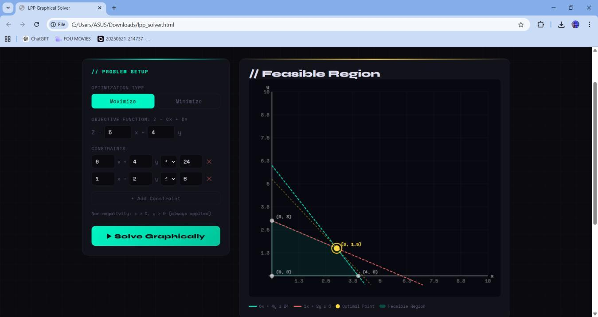
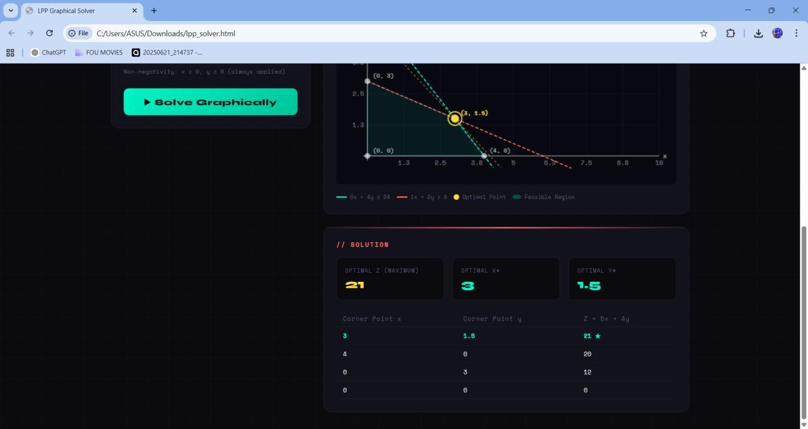
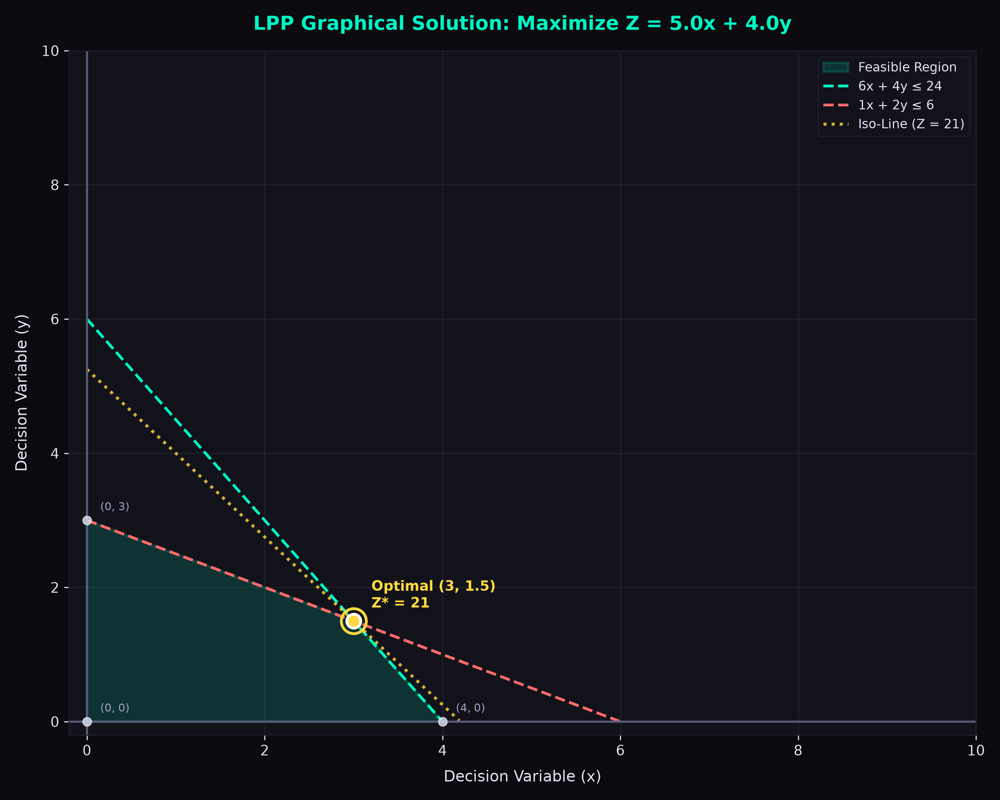

# LPP Graphical Solver (Web & Python)


A comprehensive two-variable **Linear Programming Problem (LPP) Solver** implementing the **Graphical Corner Point (Vertex) Method**, available as both a standalone **Python CLI/Desktop application** and a **zero-dependency interactive HTML5 Canvas web application**.

Accompanied by the complete 21-page academic research and project report: [`lpp_report.pdf`](lpp_report.pdf).

---

## 📸 Screenshots & Previews

### 1. Interactive Web Interface (HTML5 / Canvas)
*(Extracted from official documentation `lpp_report.pdf`)*

| Optimal Solution & Feasible Region | Full Interactive Parameter Panel |
| :---: | :---: |
|  |  |
| *Figure 1: Feasible polygon with gold optimal highlight & iso-profit line* | *Figure 2: Real-time form controls, dynamic constraints & results table* |

---

### 2. Python Matplotlib Graphical Output (`lpp_solver.py`)

<p align="center">
  
</p>

*Figure 3: Generated Matplotlib graphical plot showing constraints $6x + 4y \le 24$, $x + 2y \le 6$, feasible polygon, corner points, and optimal vertex $(3, 1.5)$ with $Z^* = 21$.*

---

## 🧮 Mathematical Method (Corner Point / Vertex Method)

The graphical method solves two-variable linear optimization models:
$$\begin{aligned}
\text{Optimize (Max / Min)} \quad & Z = c \cdot x + d \cdot y \\
\text{Subject to} \quad & a_i \cdot x + b_i \cdot y \,\, \{\le, \ge, =\} \,\, \text{rhs}_i \quad (i = 1, \dots, m) \\
& x \ge 0, \quad y \ge 0 \quad (\text{Non-negativity})
\end{aligned}$$

### Algorithmic Steps:
1. **Line & Axis Intersections:** Computes all pairwise intersection coordinates between linear boundary lines:
   $$x = \frac{\text{rhs}_1 b_2 - \text{rhs}_2 b_1}{a_1 b_2 - a_2 b_1}, \quad y = \frac{a_1 \text{rhs}_2 - a_2 \text{rhs}_1}{a_1 b_2 - a_2 b_1}$$
   plus their intersections with the coordinate axes ($x = 0$ and $y = 0$).
2. **Feasibility Filtering:** Evaluates each candidate point $(x, y)$ against all constraint inequalities. Points violating any constraint are eliminated.
3. **Convex Hull Ordering:** Orders surviving feasible corner points angularly around their centroid $(\bar{x}, \bar{y})$ using $\text{atan2}(y - \bar{y}, x - \bar{x})$ to render the shaded feasible polygon.
4. **Vertex Evaluation:** Evaluates $Z = c \cdot x + d \cdot y$ at every corner point.
5. **Optimal Selection:** Determines the maximum or minimum value. Multiple points sharing $Z^*$ are flagged as alternative optimal solutions along that boundary edge.
6. **Iso-Profit / Iso-Cost Overlay:** Projects the dashed line $c \cdot x + d \cdot y = Z^*$ through the optimal point.

---

## 📊 Default Textbook Example

$$\begin{aligned}
\text{Maximize} \quad & Z = 5x + 4y \\
\text{Subject to} \quad & 6x + 4y \le 24 \\
& 1x + 2y \le 6 \\
& x \ge 0, \quad y \ge 0
\end{aligned}$$

### Solution Breakdown:

| Corner Point $(x, y)$ | Objective Value $Z = 5x + 4y$ | Classification |
| :---: | :---: | :---: |
| $(0.00, 0.00)$ | $0.00$ | Feasible (Origin) |
| $(0.00, 3.00)$ | $12.00$ | Feasible |
| **$(3.00, 1.50)$** | **$21.00$** | ★ **OPTIMAL MAXIMUM** |
| $(4.00, 0.00)$ | $20.00$ | Feasible |

---

## 🚀 Quick Start Guide

### Option A: Run via Python (`lpp_solver.py`)

#### 1. Install Dependencies
```bash
pip install -r requirements.txt
```

#### 2. Run the Default Problem with Plot
```bash
python lpp_solver.py --plot
```

#### 3. Solve Custom Problems via CLI
```bash
# Maximize Z = 3x + 2y with 3 constraints and save the plot image
python lpp_solver.py --opt max --obj 3 2 \
  -c "2 1 <= 18" \
  -c "2 3 <= 42" \
  -c "3 1 <= 24" \
  --save custom_solution.png --plot
```

#### 4. Interactive Console Mode
```bash
python lpp_solver.py --interactive
```

---

### Option B: Run in Web Browser (`lpp_solver.html`)

No installation or build tools required:
- Simply open [`lpp_solver.html`](lpp_solver.html) directly in any browser (Chrome, Edge, Firefox, Safari).
- Or run locally:
  ```bash
  # Windows
  start lpp_solver.html
  # macOS
  open lpp_solver.html
  ```

---

## 📁 Repository Structure

```
├── lpp_solver.py                      # Complete Python solver (CLI, math, and Matplotlib plotting)
├── lpp_solver.html                    # Interactive zero-dependency HTML5 Canvas web application
├── lpp_report.pdf                     # 21-page academic project and research documentation (4.2 MB)
├── requirements.txt                   # Python dependencies (numpy, matplotlib)
├── .gitignore                         # Standard Python ignores
└── screenshots/                       # High-resolution documentation and UI screenshots
    ├── screenshot1_optimal_solution.jpg
    ├── screenshot2_full_interface.jpg
    └── python_plot_output.png
```

---

## 👤 Author
**Ashbi Saju**  
GitHub: [@aashbiii](https://github.com/aashbiii)  
Academic Affiliation: Rajagiri College of Social Sciences (Autonomous) — MCA
